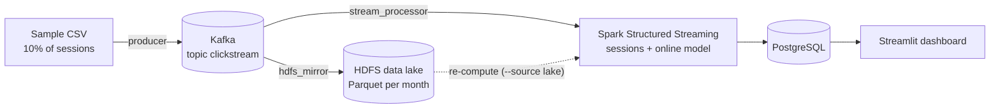

# Kappa Purchase Intent

Near real-time purchase prediction for e-commerce sessions, built on a Kappa architecture. Every
session is scored at its third event, before the visitor has decided, and the model keeps learning
as each session's outcome becomes known.

Seven months of clickstream data (41.1 million events, a 10% session sample of the REES46 dataset)
flow through Kafka, are mirrored to an HDFS data lake, processed by Spark Structured Streaming with
an online logistic regression (River), stored in PostgreSQL and monitored in a Streamlit dashboard.

Course project for Teknologi Big Data (TPL1309), Sekolah Vokasi IPB University.

## Architecture



| Layer | Component | Role |
|---|---|---|
| Ingestion | `pipeline/producer.py` | Replays the sample file into Kafka in event order |
| Unified log | Kafka (topic `clickstream`, 1 partition) | Ordered, replayable event log |
| Data lake | `pipeline/hdfs_mirror.py` | Separate streaming job that copies every event to HDFS as Parquet, with its Kafka offset |
| Processing | `pipeline/stream_processor.py` | Two streaming queries on the same source: sessions with online learning, and category statistics |
| Serving | PostgreSQL (`sql/schema.sql`) | Predictions, evaluation log, model state, daily metrics |
| Dashboard | `dashboard.py` | Pipeline status, model performance and customer behaviour |

The same `stream_processor` code reads either Kafka or the HDFS lake. Re-computing results means
replaying the log through the same job, not running a separate batch layer.

## How it works

**Sessions.** A gap of more than 30 minutes ends a session; later events with the same
`user_session` are ignored. Spark keeps the session state in `applyInPandasWithState`, grouped
into 256 hash buckets of `user_session`, with event-time timeouts and a one-minute watermark.

**Prediction.** When a session reaches its third event without a purchase, four features are
computed from those three events: number of add-to-cart events, log of the average and maximum
valid price, and log of the time from event 1 to event 3. The label is a purchase after the third
event, before the session ends.

**Online learning.** A River pipeline (standard scaler and logistic regression, AdaGrad 0.5)
predicts when a session is scored and learns when the session closes. Each score is made before
the outcome is known (prequential evaluation).

**Exactly-once results.** For every micro-batch, the model, active predictions, evaluation rows and
the batch id are committed in one PostgreSQL transaction, so a batch replayed after a restart is
skipped.

**Category statistics.** A second streaming query counts views, carts and purchases per category
through a broadcast join with a product-to-category table built from October and November 2019,
because `category_code` in the source data is inconsistent from December 2019 onwards.

## Results

Full 7-month run, re-computed from the HDFS lake. Test period: 26 Feb to 30 Apr 2020,
1,118,766 scored sessions, 9.2% purchase rate. Full tables are in `results/`.

| Model (test period) | ROC-AUC | PR-AUC | Precision@5% |
|---|---|---|---|
| Online logistic regression (pipeline, prequential) | 0.735 | 0.298 | 42% (lift 4.6x) |
| Logistic regression trained once on the earlier 70% | 0.734 | 0.293 | 42% |
| Gradient boosting on the same four features | 0.744 | 0.317 | 46% |
| Rule: session has an add-to-cart event | 0.682 | 0.266 | 41% |
| Random | 0.499 | 0.091 | 9% |

- The 1% highest-scored sessions have a precision of 54% (lift 5.9x).
- The simple cart rule is a strong baseline when about 11% of sessions are flagged; the model adds
  value by ranking within that group.
- The ceiling comes from the features, not the model: logistic regression with interaction
  features reaches the same ROC-AUC as gradient boosting (0.744).

**Correctness checks**

| Check | Result |
|---|---|
| `evaluation/compare_with_reference.py`: every session against an independent DuckDB answer key | 3,729,218 finished sessions identical in features, label and timestamps; 190 still open; 0 missing, 0 extra |
| `evaluation/check_descriptive.py`: category counts against a DuckDB recount | 41,135,649 events, all 14 categories identical |
| `pipeline/verify_mirror.py`: HDFS lake against Kafka offsets | 0 duplicate offsets, 0 gaps, files in replay order |

## Requirements

- Python 3 with the packages in `requirements.txt` (PySpark 4.2, River, DuckDB 1.5.6, Streamlit)
- Java 17
- Docker for Kafka (`apache/kafka:3.9.0`) and HDFS (`apache/hadoop:3`, see `infra/hdfs/`)
- PostgreSQL 18

**Windows notes**

- Hadoop `winutils.exe` under `C:\hadoop\bin` (the scripts set `HADOOP_HOME=C:\hadoop` if missing).
- PyArrow needs a time-zone database: `python -c "import pyarrow.util as u; u.download_tzdata_on_windows()"`.
- Add `127.0.0.1 namenode` and `127.0.0.1 datanode` to the hosts file so Spark can reach the HDFS containers.

## Setup

```bash
pip install -r requirements.txt

# PostgreSQL: the password is read from the environment, never from the code
createdb -U postgres ecommerce_db
psql -U postgres -d ecommerce_db -f sql/schema.sql
conda env config vars set PGPASSWORD=<your password>   # or export PGPASSWORD=...

# Kafka and HDFS
docker run -d --name kafka -p 9092:9092 apache/kafka:3.9.0
cd infra/hdfs && docker compose up -d && cd ../..
python infra/hdfs/test_spark_hdfs.py
```

Connection settings live in `db_config.py` (`PGHOST`, `PGPORT`, `PGDATABASE`, `PGUSER`, `PGPASSWORD`).

## Data

Source: [eCommerce behavior data from multi category store](https://www.kaggle.com/datasets/mkechinov/ecommerce-behavior-data-from-multi-category-store)
(REES46). Kaggle hosts October and November 2019; the remaining months up to April 2020 are
available from REES46 through the dataset page. Place the monthly files in `data/`.

```bash
# 10% of sessions, selected by hash(user_session), so sessions stay whole
python -m prep.make_sample --pct 10 --glob "data/20*.csv" --out sample/sample_10pct.csv
python -m prep.make_sample --pct 10 --glob "data/2020-*.csv.gz" --out sample/sample_10pct_marapr.csv   # March and April are distributed compressed
python -m prep.merge_samples --inputs sample/sample_10pct.csv sample/sample_10pct_marapr.csv \
    --out sample/sample_10pct_7bulan.csv

python -m prep.validate_sample              # sample vs population, per month and category
python -m prep.build_product_category       # ref/product_category.parquet
python -m evaluation.build_session_reference --out ref/session_reference_7m.parquet
```

## Running

```bash
# 1. topic with one partition
python -c "from kafka.admin import KafkaAdminClient, NewTopic; KafkaAdminClient(bootstrap_servers='localhost:9092').create_topics([NewTopic('clickstream', 1, 1)])"

# 2. three processes, each in its own terminal
python -m pipeline.stream_processor --reset
python -m pipeline.hdfs_mirror
python -m pipeline.producer --file sample/sample_10pct_7bulan.csv

# 3. dashboard
streamlit run dashboard.py
```

**Re-compute from the data lake** (Kafka not needed):

```bash
python -m pipeline.stream_processor --source lake --reset --once
```

`--start-offset N` skips events before Kafka offset `N`, for example an accidental re-send at the
start of the topic (`evaluation/check_resent_prefix.py` detects one).

**Verification and evaluation**

```bash
python -m pipeline.verify_mirror
python -m evaluation.compare_with_reference --reference ref/session_reference_7m.parquet
python -m evaluation.check_descriptive

python -m evaluation.full_evaluation        # metrics, calibration, ablation, monthly
python -m evaluation.threshold_table
python -m evaluation.compare_nonlinear
python -m evaluation.compare_interactions
```

## Repository layout

| Path | Contents |
|---|---|
| `pipeline/` | Producer, HDFS mirror, stream processor, session logic, online learner, category query |
| `prep/` | Sampling, sample validation, data-quality reports, category mapping |
| `evaluation/` | Answer keys, correctness checks, model evaluation and comparisons |
| `results/` | Evaluation and data-quality outputs (CSV) |
| `sql/schema.sql` | PostgreSQL tables |
| `infra/hdfs/` | Single-node HDFS with Docker Compose |
| `dashboard.py` | Streamlit dashboard |

## Limitations

- The data is a 10% session sample. Rates and model metrics are representative; absolute volumes are a tenth of the store's traffic.
- The source has gaps and anomalies, for example 15 Nov 2019 with traffic but no purchases, and
  inconsistent `category_code` from December 2019. They are kept as they are and reported.
- Average and maximum price are strongly correlated (0.98), so their weights should not be read as feature importance; the ablation study in `results/ablation.csv` measures importance.
- A purchase prediction is not the effect of an intervention. Targeting high scores with discounts
  would need an A/B test or uplift modelling.
- Every closed session ID is remembered for the whole run (about 72 MB for seven months). A
  long-running system would need a retention period.
