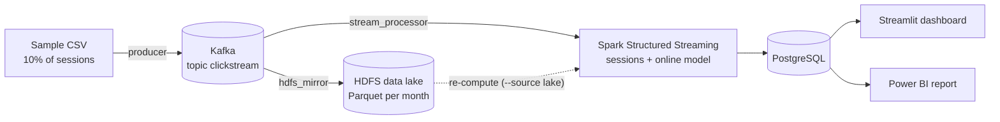
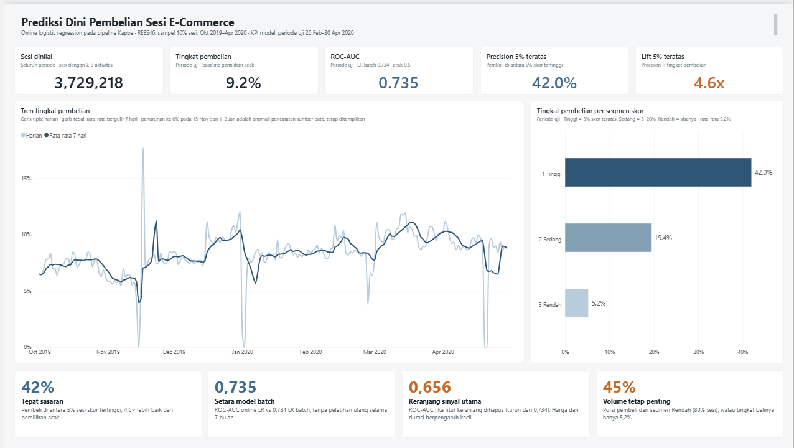
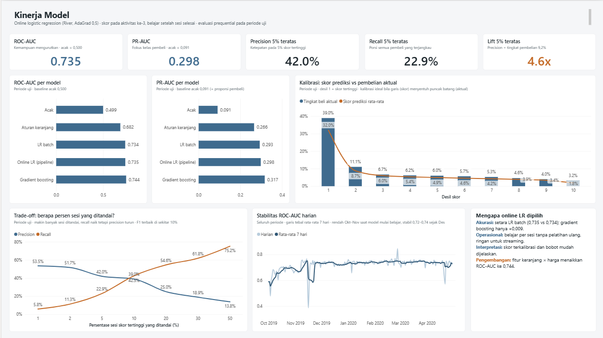
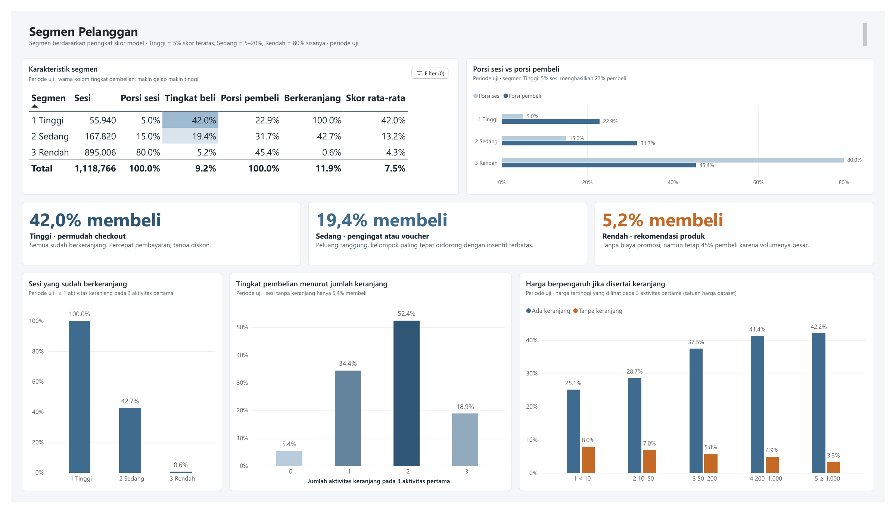
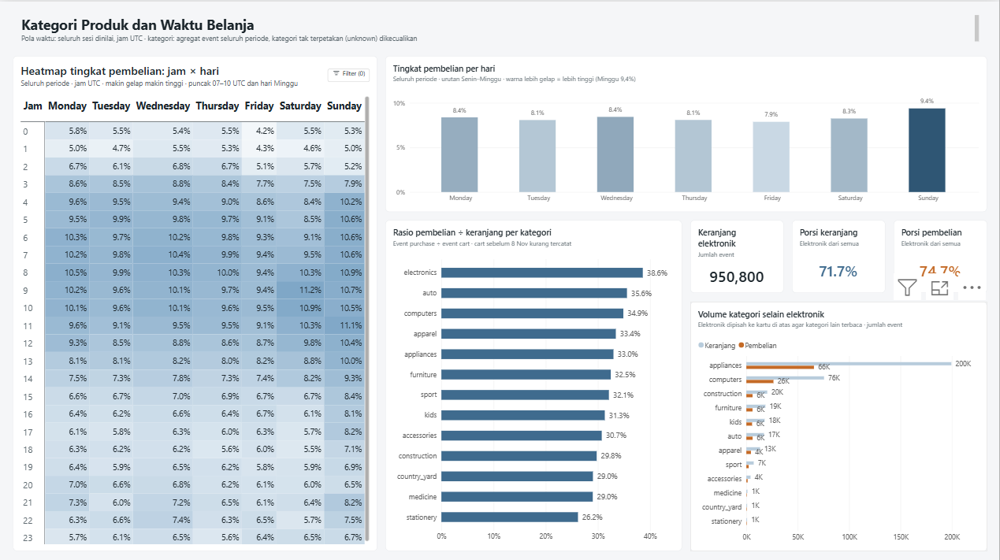

# Kappa Purchase Intent

Near real-time purchase prediction for e-commerce sessions, built on a Kappa architecture. Every
session is scored at its third event, before the visitor has decided, and the model keeps learning
as each session's outcome becomes known.

Seven months of clickstream data (41.1 million events, a 10% session sample of the REES46 dataset)
flow through Kafka, are mirrored to an HDFS data lake, processed by Spark Structured Streaming with
an online logistic regression (River), stored in PostgreSQL, monitored in a Streamlit dashboard
and analysed in a Power BI report.

Course project for Teknologi Big Data (TPL1309), Sekolah Vokasi IPB University.

## Architecture



| Layer | Component | Role |
|---|---|---|
| Ingestion | `pipeline/producer.py` | Replays the sample file into Kafka in event order |
| Unified log | Kafka (topic `clickstream`, 1 partition) | Ordered, replayable event log |
| Data lake | `pipeline/hdfs_mirror.py` | Separate streaming job that copies every event to HDFS as Parquet, with its Kafka offset |
| Processing | `pipeline/stream_processor.py` | Two streaming queries on the same source: sessions with online learning, and category statistics |
| Serving | PostgreSQL (`sql/schema.sql`) | Predictions, evaluation log, model state, daily metrics |
| Dashboard | `dashboard.py` | Pipeline status, model performance and customer behaviour |
| BI report | `powerbi/` | Four-page analytical report on the serving layer |

The same `stream_processor` code reads either Kafka or the HDFS lake. Re-computing results means
replaying the log through the same job, not running a separate batch layer.

## How it works

**Sessions.** A gap of more than 30 minutes ends a session; later events with the same
`user_session` are ignored. Spark keeps the session state in `applyInPandasWithState`, grouped
into 256 hash buckets of `user_session`, with event-time timeouts and a one-minute watermark.

**Prediction.** When a session reaches its third event without a purchase, four features are
computed from those three events: number of add-to-cart events, log of the average and maximum
valid price (price > 0), and log of the time from event 1 to event 3. The label is a purchase after
the third event, before the session ends.

**Online learning.** A River pipeline (standard scaler and logistic regression, AdaGrad 0.5)
predicts when a session is scored and learns when the session closes. Each score is made before
the outcome is known (prequential evaluation). The optimizer and learning rate were chosen on a
validation split inside the first 70% of sessions, without touching the test period.

**Idempotent results per micro-batch.** For every micro-batch, the model, active predictions,
evaluation rows and the batch id are committed in one PostgreSQL transaction, so a batch replayed
after a restart is skipped. Kafka offsets themselves live in the Spark checkpoint, and the producer
is not exactly-once: an accidental re-send of 120,714 events at the start of the topic is skipped
with `--start-offset`.

**Category statistics.** A second streaming query counts views, carts and purchases per category
through a broadcast join with a product-to-category table built from October and November 2019,
because `category_code` in the source data is inconsistent from December 2019 onwards. Products
without a category in October and November 2019 are counted as `unknown`.

## Results

Full 7-month run, re-computed from the HDFS lake. Test period: 26 Feb to 30 Apr 2020,
1,118,766 scored sessions, 9.2% purchase rate. Full tables are in `results/`.

| Model (test period) | ROC-AUC | PR-AUC | Precision@5% |
|---|---|---|---|
| Online logistic regression (pipeline, prequential) | 0.735 | 0.298 | 42% (lift 4.6x) |
| Logistic regression trained once on the earlier 70% | 0.734 | 0.293 | 42% |
| Gradient boosting on the same four features | 0.744 | 0.317 | 46% |
| Rule: session has an add-to-cart event | 0.682 | 0.266 | 41% |
| Random | 0.499 | 0.091 | 9% |

- The 1% highest-scored sessions have a precision of 54% (lift 5.9x). The best F1 (0.42) is reached
  when about 10% of sessions are flagged (`results/thresholds.csv`).
- The simple cart rule is a strong baseline when about 11% of sessions are flagged; the model adds
  value by ranking within that group.
- The ceiling comes from the features, not the model: logistic regression with interaction
  features reaches the same ROC-AUC as gradient boosting (0.744).
- Scores are well calibrated (ECE 0.017, `results/calibration.csv`).
- Predicting at the third event is the best trade-off: waiting until the fifth event raises ROC-AUC
  only to 0.746, while the share of buyer sessions that can still be reached falls from 58% to 34%
  (`results/insight_early_k.csv`).
- Score segments on the test period, with thresholds fixed on the earlier 70%: the top 5% of
  sessions buy at 41.8%, the next 15% at 17.8% and the remaining 80% at 5.2%
  (`results/insight_seg_segments.csv`).
- Cart abandonment since 8 Nov 2019: 54.5% of sessions with a cart end without a purchase; 62% of
  the value left in carts is electronics (`results/insight_p5_*_since20191108.csv`).

**Correctness checks**

| Check | Result |
|---|---|
| `evaluation/compare_with_reference.py`: every session against an independent DuckDB answer key | 3,729,218 finished sessions identical in features, label and timestamps; 190 still open; 0 missing, 0 extra |
| `evaluation/check_descriptive.py`: category counts against a DuckDB recount | 41,135,649 events, all 14 categories identical |
| `pipeline/verify_mirror.py`: HDFS lake against Kafka offsets | 0 duplicate offsets, 0 gaps, files in replay order |

**Data quality and robustness checks**

| Check | Result |
|---|---|
| `prep/check_missing.py`: missing values in all 7 months (411.7 million rows) | No missing values in the columns the model uses; missing only in `category_code` (15.8%) and `brand` (13.5%), not model features; price ≤ 0 in 0.17% of rows, excluded from the price features; 226 rows without `user_session`, excluded |
| `prep/validate_sample.py`: 10% sample against the population | Session ratio 0.0999 to 0.1001 per month; event-type shares within 0.065 pp; category shares within 0.045 pp |
| `evaluation/check_duplicate_sensitivity.py`: exact duplicate rows (0.34%) kept vs removed | Removing them changes 0.47% of scored sessions, no labels, and ROC-AUC of the batch model by 0.002 (0.734 to 0.732) |
| `evaluation/tune_validation.py`: optimizer and learning rate on the validation split | AdaGrad is stable from 0.1 to 2.0 (ROC-AUC 0.745 to 0.747); SGD drops from 0.744 to 0.720 as the learning rate grows; AdaGrad 0.5 is within 0.0003 of the best |
| `evaluation/check_cart_logging.py`: daily carts vs purchases | Cart events are incomplete before 8 Nov 2019; behaviour analyses on carts use data from that date |

## Power BI report

A four-page report on the PostgreSQL serving layer, saved as a Power BI Project
(`powerbi/kappa_purchase_intent_dashboard.pbip`).

| Page | Question it answers |
|---|---|
| Ringkasan | How often do sessions convert, and how well does the model rank them? |
| Kinerja Model | How does the online model compare with baselines, and is it calibrated? |
| Segmen Pelanggan | Which score segments matter and what action fits each one? |
| Kategori dan Waktu | When do visitors buy, and which categories convert from cart? |






**Data model.** `Sesi` is the fact table (3.7M scored sessions from `pbi_sessions`, features
back-transformed from log scale, a test-period flag and a score percentile within each period),
joined to a `Tanggal` date dimension and `Metrik Harian`. `Kategori` holds category event counts.
Two small calculated tables support the model comparison (`Benchmark Model`) and the top-K
trade-off (`Target K`).

**Key DAX measures.** `Precision @K`, `Recall @K` and `Lift @K` evaluate the top K% of the test
period dynamically; `Porsi Pembeli (Uji)` gives each segment's share of buyers; `AUC Rata-rata`
is the session-weighted daily ROC-AUC, excluding days without buyers; 7-day rolling averages use
`DATESINPERIOD`.

**Metric notes.**
- Model KPIs use the test period and match `results/metrics.csv`. Baseline scores come from the
  offline evaluation and are not recomputed in Power BI.
- Report segments are exact percentiles within the test period (5% / 15% / 80%, buying at 42.0%,
  19.4% and 5.2%). The results above fix thresholds on the earlier 70% instead (41.8%, 17.8%,
  5.2%), so the two sets of figures differ slightly by design.
- Category figures are event counts for the whole period, excluding `unknown`. Electronics is
  shown separately (71.7% of carts) so the other categories stay readable.

## Requirements

- Python 3 with the packages in `requirements.txt` (PySpark 4.2, River, DuckDB 1.5.6, Streamlit)
- Java 17
- Docker for Kafka (`apache/kafka:3.9.0`) and HDFS (`apache/hadoop:3`, see `infra/hdfs/`)
- PostgreSQL 18
- Power BI Desktop (Windows) for the report

**Windows notes**

- Hadoop `winutils.exe` under `C:\hadoop\bin` (the scripts set `HADOOP_HOME=C:\hadoop` if missing).
- PyArrow needs a time-zone database: `python -c "import pyarrow.util as u; u.download_tzdata_on_windows()"`.
- Add `127.0.0.1 namenode` and `127.0.0.1 datanode` to the hosts file so Spark can reach the HDFS containers.

## Setup

```bash
pip install -r requirements.txt

# PostgreSQL: the password is read from the environment, never from the code
createdb -U postgres ecommerce_db
psql -U postgres -d ecommerce_db -f sql/schema.sql
conda env config vars set PGPASSWORD=<your password>   # or export PGPASSWORD=...

# Kafka and HDFS
docker run -d --name kafka -p 9092:9092 apache/kafka:3.9.0
cd infra/hdfs && docker compose up -d && cd ../..
python infra/hdfs/test_spark_hdfs.py
```

Connection settings live in `db_config.py` (`PGHOST`, `PGPORT`, `PGDATABASE`, `PGUSER`, `PGPASSWORD`).

## Data

Source: [eCommerce behavior data from multi category store](https://www.kaggle.com/datasets/mkechinov/ecommerce-behavior-data-from-multi-category-store)
(REES46). Kaggle hosts October and November 2019; the remaining months up to April 2020 are
available from REES46 through the dataset page. Place the monthly files in `data/`.

```bash
python -m prep.check_missing                # missing values per column, all months (.csv and .csv.gz)

# 10% of sessions, selected by hash(user_session), so sessions stay whole
python -m prep.make_sample --pct 10 --glob "data/20*.csv" --out sample/sample_10pct.csv
python -m prep.make_sample --pct 10 --glob "data/2020-*.csv.gz" --out sample/sample_10pct_marapr.csv   # March and April are distributed compressed
python -m prep.merge_samples --inputs sample/sample_10pct.csv sample/sample_10pct_marapr.csv \
    --out sample/sample_10pct_7bulan.csv

python -m prep.validate_sample              # sample vs population, per month and category
python -m prep.report_stats                 # duplicates, task coverage, label definitions
python -m prep.check_category_shift         # category_code changes from December 2019
python -m prep.build_product_category       # ref/product_category.parquet
python -m evaluation.build_session_reference --out ref/session_reference_7m.parquet
```

## Running

```bash
# 1. topic with one partition
python -c "from kafka.admin import KafkaAdminClient, NewTopic; KafkaAdminClient(bootstrap_servers='localhost:9092').create_topics([NewTopic('clickstream', 1, 1)])"

# 2. three processes, each in its own terminal
python -m pipeline.stream_processor --reset
python -m pipeline.hdfs_mirror
python -m pipeline.producer --file sample/sample_10pct_7bulan.csv

# 3. dashboard
streamlit run dashboard.py
```

**Re-compute from the data lake** (Kafka not needed):

```bash
python -m pipeline.stream_processor --source lake --reset --once
```

`--start-offset N` skips events before Kafka offset `N`, for example an accidental re-send at the
start of the topic (`evaluation/check_resent_prefix.py` detects one).

**Verification**

```bash
python -m pipeline.verify_mirror
python -m evaluation.compare_with_reference --reference ref/session_reference_7m.parquet
python -m evaluation.check_descriptive
```

**Model evaluation** (reads `eval_log` from PostgreSQL unless noted)

```bash
python -m evaluation.full_evaluation        # metrics, calibration, ablation, monthly
python -m evaluation.threshold_table
python -m evaluation.compare_nonlinear
python -m evaluation.compare_interactions
python -m evaluation.tune_validation        # optimizer and learning rate on a validation split (answer key only)

# duplicate sensitivity (answer keys only)
python -m evaluation.build_session_reference --dedup --out ref/session_reference_7m_dedup.parquet
python -m evaluation.check_duplicate_sensitivity
```

**Behaviour analyses** (outside the pipeline, read-only)

```bash
python -m evaluation.check_cart_logging
python -m evaluation.build_session_insights
for k in 5 7 10; do python -m evaluation.build_session_reference --k $k --out ref/session_reference_k$k.parquet; done
python -m evaluation.analyze_insights --part p2 p5 p6 p7 --since 2019-11-08   # carts complete from 8 Nov 2019
python -m evaluation.analyze_insights --part anom seg early
```

**Power BI report**

```bash
psql -U postgres -d ecommerce_db -f sql/pbi_sessions.sql
```

Open `powerbi/kappa_purchase_intent_dashboard.pbip` in Power BI Desktop and click **Refresh**.

## Repository layout

| Path | Contents |
|---|---|
| `pipeline/` | Producer, HDFS mirror, stream processor, session logic, online learner, category query |
| `prep/` | Missing values, sampling, sample validation, data-quality reports, category mapping |
| `evaluation/` | Answer keys, correctness checks, model evaluation, robustness checks, behaviour analyses |
| `results/` | Evaluation, data-quality and behaviour outputs (CSV) |
| `sql/schema.sql` | PostgreSQL tables |
| `infra/hdfs/` | Single-node HDFS with Docker Compose |
| `dashboard.py` | Streamlit dashboard |
| `powerbi/` | Power BI Project (report and semantic model) |
| `docs/powerbi/` | Report screenshots |
| `sql/pbi_sessions.sql` | Session table for the Power BI report |

## Limitations

- The data is a 10% session sample. Rates and model metrics are representative; absolute volumes are a tenth of the store's traffic.
- Sampling is by session, not by user, so a user's history is incomplete in the sample. Analyses per
  user (returning visitors, visit order) are therefore not reported; all analyses are per session.
- The source has gaps and anomalies, for example 15 Nov 2019 with traffic but no purchases, and
  inconsistent `category_code` from December 2019. They are kept as they are and reported.
- Categories come from October and November 2019. The share of events with a category falls from
  about 68% in October to 52% in April 2020 as new products appear, so category results for later
  months cover older products only.
- Cart events are incomplete before 8 Nov 2019. The model still trains on these weeks, which partly
  explains the lower ROC-AUC in October and November.
- Average and maximum price are strongly correlated (0.98), so their weights should not be read as feature importance; the ablation study in `results/ablation.csv` measures importance.
- Cart abandonment is measured per session; a visitor may buy in a later session, so the rate is an upper bound.
- Hours are in UTC; the customers' time zone is not known.
- A purchase prediction is not the effect of an intervention. Targeting high scores with discounts
  would need an A/B test or uplift modelling.
- Every closed session ID is remembered for the whole run (about 72 MB for seven months). A
  long-running system would need a retention period.
